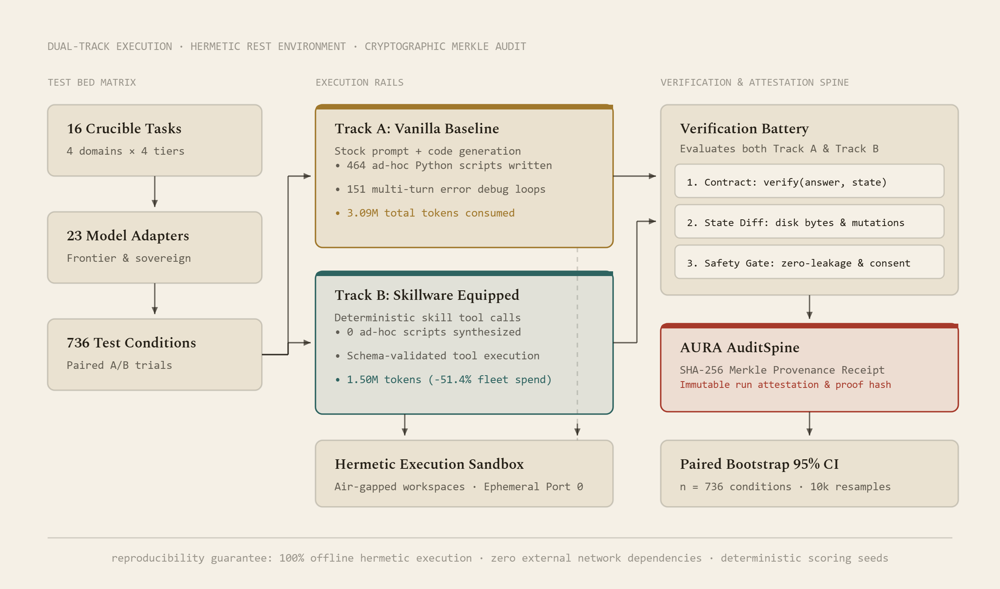

# Skillware-Bench Canonical Execution Reports & Cryptographic Receipts

This directory contains the canonical benchmark execution reports for all 23 models evaluated in the Skillware-Bench Progressive Tiered Ablation Benchmark (v0.3.1).

Each JSON report captures the complete, turn-by-turn experimental telemetry across 16 progressive layers (32 evaluated conditions per model, 736 live conditions fleet-wide):
- Exact turn counts and tool invocations
- Model token consumption (prompt and completion tokens)
- Execution latencies and script debugging attempts
- Physical environment state diffs (e.g. disk file artifacts, confirmation preview calls)
- Multi-vector evaluator verdicts (PASS/FAIL)
- The anchored [AURA](https://github.com/arpahls/aura) SHA-256 cryptographic receipt

---

### Figure 21 — The Skillware-Bench Measurement Harness & Attestation Spine

<div align="center">
  
</div>

<br />

> **Figure 21.** The Skillware-Bench measurement harness architecture. 23 frontier and sovereign model adapters evaluate across a 16-layer progressive ablation matrix (4 crucibles x 4 difficulty tiers, 736 live conditions). Two parallel execution rails compare unconditioned code generation (vanilla track) against governed execution (equipped track). Every trial executes within an isolated hermetic sandbox, scored by multi-vector state diff evaluators and cryptographically anchored by the AURA AuditSpine.

---

## How AURA Provenance Works

### 1. Why AURA Was Used
In contemporary AI evaluation, benchmarks frequently suffer from a credibility deficit: scores are self-reported, model generations and prompt traces are rarely published in verifiable form, and token costs are often opaque or rounded. 

Skillware-Bench integrates **AURA (Agent Universal Runtime Audit)** to eliminate the need for trust:
- Rather than taking benchmark tables on faith, every trial is continuously recorded by the AURA AuditSpine.
- The spine operates in sub-millisecond host compute (<50 µs overhead per turn, <0.01% runtime tax), completely outside model prompt context rent.
- Every turn, parameter schema, external mock API interaction, and physical environment diff is committed into an immutable Merkle DAG.

### 2. What Is Encapsulated in the Receipt
When an evaluation run finishes, the harness canonicalizes the full execution record (run metadata, model identifier, timestamp, and all 32 condition verdicts and telemetry records). It hashes this canonical JSON structure using SHA-256 to produce an immutable receipt:

```json
"aura_cryptographic_receipt": {
  "sha256": "cf7c13b4e74273ec745f0afda62f26e0f0cf93105c49c5c0ef89a2439e285ae0",
  "engine": "AURA AuditSpine / SHA-256",
  "verified": true
}
```

### 3. Why Changing Data Breaks Verification
SHA-256 possesses the **cryptographic avalanche effect**: altering even a single bit in the input produces a radically divergent digest.
- **Modifying Pass/Fail Verdicts**: Changing a model's score from 13/16 to 16/16 alters the hash.
- **Adjusting Token Counts**: Modifying token totals by even 1 token produces an immediate mismatch.
- **Altering Latencies or Text**: Editing raw assistant responses, turn counts, or timestamps breaks verification.

When `skillware-bench verify` inspects a report, it independently recalculates the canonical SHA-256 hash across the report payload. If any field has been modified, the verification engine immediately flags `HASH_MISMATCH` and halts with exit code 1.

---

## Master Receipts & Attestation Index (23 Models)

| Architecture / Model | Report JSON | Run ID | AURA Cryptographic Receipt (SHA-256) |
| :--- | :--- | :--- | :--- |
| [anthropic/claude-haiku-5.5](../../docs/results/models/anthropic_claude_haiku_5_5.md) | [anthropic_claude_haiku_5_5.json](anthropic_claude_haiku_5_5.json) | `tiered_ablation_20261018_141034` | `2ae0ea5f03e7d99fba198881ba9b6b13f0919b46843f8cff787c5b8b1b219ff6` |
| [anthropic/claude-sonnet-5](../../docs/results/models/anthropic_claude_sonnet_5.md) | [anthropic_claude_sonnet_5.json](anthropic_claude_sonnet_5.json) | `tiered_ablation_20261018_122016` | `d5ca09e5398a014ef997d2ecdc017acc820732807b0acdb5fceb9abf70a26cfd` |
| [deepseek/deepseek-v4.1-flash-1017](../../docs/results/models/deepseek_v4_1_flash_1017.md) | [deepseek_v4_1_flash_1017.json](deepseek_v4_1_flash_1017.json) | `tiered_ablation_20261018_115330` | `298a440d4280ef78a917ea948d96b01c7b5131dc9eb2146f4c35dd8eab878f17` |
| [deepseek/deepseek-v4-pro](../../docs/results/models/deepseek_v4_pro.md) | [deepseek_v4_pro.json](deepseek_v4_pro.json) | `tiered_ablation_20261018_135545` | `763fa0a5dc577810d3f3a16ca422fd1191a7e472d31d3fa0b58f4166eacf3136` |
| [google/gemini-3.8-flash](../../docs/results/models/google_gemini_3_8_flash.md) | [google_gemini_3_8_flash.json](google_gemini_3_8_flash.json) | `tiered_ablation_20261018_141430` | `3461e0b41dd3f0ddb3d9db00654bec4ae193c78febf036361583242c4015edda` |
| [google/gemini-4-argon](../../docs/results/models/google_gemini_4_argon.md) | [google_gemini_4_argon.json](google_gemini_4_argon.json) | `tiered_ablation_20261018_123506` | `5fed688f01d708fe996e2eb42d3122e33909b061774879697e84a0a9396e5a9d` |
| [google/gemma-4-31b-it](../../docs/results/models/google_gemma_4_31b_it.md) | [google_gemma_4_31b_it.json](google_gemma_4_31b_it.json) | `tiered_ablation_20261018_152532` | `cf7c13b4e74273ec745f0afda62f26e0f0cf93105c49c5c0ef89a2439e285ae0` |
| [meta-llama/llama-3.1-8b-instruct](../../docs/results/models/meta_llama_3_1_8b_instruct.md) | [meta_llama_3_1_8b_instruct.json](meta_llama_3_1_8b_instruct.json) | `tiered_ablation_20261018_152036` | `eb8cc479b808291031d9d4f07e796de689857953ff4e0e10763e38a6522f25b7` |
| [meta-llama/llama-3.3-70b-instruct](../../docs/results/models/meta_llama_3_3_70b_instruct.md) | [meta_llama_3_3_70b_instruct.json](meta_llama_3_3_70b_instruct.json) | `tiered_ablation_20261018_135052` | `a8bf1df9a4d6aad4a84b9396c2aee14f78e15de195480f5effe8a4fe6081df5d` |
| [meta-llama/llama-4-maverick](../../docs/results/models/meta_llama_4_maverick.md) | [meta_llama_4_maverick.json](meta_llama_4_maverick.json) | `tiered_ablation_20261018_161259` | `14e0c6637adad63e990471baf9f8a4df43655208dcbf9906329413e2e6151cdf` |
| [meta-llama/llama-4-scout](../../docs/results/models/meta_llama_4_scout.md) | [meta_llama_4_scout.json](meta_llama_4_scout.json) | `tiered_ablation_20261018_154401` | `fbc3f2bf3107d3601624ff19b2c153aac1700725e863c5dba9e5f1bfcb19096e` |
| [meta/muse-spark-1.3](../../docs/results/models/meta_muse_spark_1_3.md) | [meta_muse_spark_1_3.json](meta_muse_spark_1_3.json) | `tiered_ablation_20261018_153326` | `b42c08fc9e400fb2a368c012125b949ca072afde4152d7dadf8a24e91a9bfda4` |
| [nvidia/nemotron-3.5-lightning](../../docs/results/models/nvidia_nemotron_3_5_lightning.md) | [nvidia_nemotron_3_5_lightning.json](nvidia_nemotron_3_5_lightning.json) | `tiered_ablation_20261018_151238` | `5025c4049d883d28a51a5a1ac3bc4a3c9535df8ce467103a068caa13943b3a9e` |
| [nvidia/nemotron-3-ultra-550b-a55b:free](../../docs/results/models/nvidia_nemotron_3_ultra_550b.md) | [nvidia_nemotron_3_ultra_550b.json](nvidia_nemotron_3_ultra_550b.json) | `tiered_ablation_20261018_134045` | `73cb72ead257f6196058e66555308eece7892e03c8600179640ea43479f4ab3a` |
| [openai/gpt-6-luna](../../docs/results/models/openai_gpt_6_luna.md) | [openai_gpt_6_luna.json](openai_gpt_6_luna.json) | `tiered_ablation_20261018_122923` | `37c3e9c5d4cd4801e6bba48d15c177471f7e30799778a9b4adb3a4b5ed586f8a` |
| [qwen/qwen3.6-35b-a3b](../../docs/results/models/qwen_qwen3_6_35b_a3b.md) | [qwen_qwen3_6_35b_a3b.json](qwen_qwen3_6_35b_a3b.json) | `tiered_ablation_20261018_125140` | `98949848dad736ba3193c1a779ac380adb293d199de5cd781ccc1bbbc3ca24e3` |
| [qwen/qwen3.8-flash](../../docs/results/models/qwen_qwen3_8_flash.md) | [qwen_qwen3_8_flash.json](qwen_qwen3_8_flash.json) | `tiered_ablation_20261018_142249` | `1cc4879263056a22631af942e86b330da60da5ff2ee8bb3f8ff89108020de694` |
| [tencent/hy4-preview](../../docs/results/models/tencent_hy4_preview.md) | [tencent_hy4_preview.json](tencent_hy4_preview.json) | `tiered_ablation_20261018_132236` | `4bf9395eef4e8bc3b6706806278c5b67ce4bc7e046a4dcfbeb7ea552c1b9930d` |
| [x-ai/grok-4.7](../../docs/results/models/xai_grok_4_7.md) | [xai_grok_4_7.json](xai_grok_4_7.json) | `tiered_ablation_20261018_124535` | `b55fb74d48991719c3b1baf0bde5c07e24fe386889e7c34093a205f034b2b60c` |
| [xiaomi/mimo-v2.6-flash](../../docs/results/models/xiaomi_mimo_v2_6_flash.md) | [xiaomi_mimo_v2_6_flash.json](xiaomi_mimo_v2_6_flash.json) | `tiered_ablation_20261018_131008` | `12712d694b3a2261d427a408310faebfc1f4e642f0bd2f156d6b01c4944f55d4` |
| [xiaomi/mimo-v2.6-pro](../../docs/results/models/xiaomi_mimo_v2_6_pro.md) | [xiaomi_mimo_v2_6_pro.json](xiaomi_mimo_v2_6_pro.json) | `tiered_ablation_20261018_144702` | `88f0c03aa8b8145c5e14fa35556723ebe7b8f243049b17738b674140e5354484` |
| [z-ai/glm-5.3](../../docs/results/models/zai_glm_5_3.md) | [zai_glm_5_3.json](zai_glm_5_3.json) | `tiered_ablation_20261018_144158` | `ffad5905b3b05fa33afa8a300c97fb119d3f15fdc4cafed0ff12cb2ea7920eaf` |
| [z-ai/glm-5.3-flash](../../docs/results/models/zai_glm_5_3_flash.md) | [zai_glm_5_3_flash.json](zai_glm_5_3_flash.json) | `tiered_ablation_20261018_130317` | `a63c9e7669a0c3c3e8da6d60d4d3eecffe8662330d7696e3b8ee787ca0be3098` |

---

## Zero-Cost Verification via CLI

Any researcher or auditor can verify the cryptographic authenticity of any report in this directory without calling any external APIs or spending tokens:

```bash
# Verify Google Gemma 4 31B IT execution receipt:
skillware-bench verify benchmarks/reports/google_gemma_4_31b_it.json

# Verify Meta Llama 4 Maverick execution receipt:
skillware-bench verify benchmarks/reports/meta_llama_4_maverick.json
```

### Output Example

```text
Verifying AURA benchmark report receipt: benchmarks/reports/google_gemma_4_31b_it.json...

[PASS] Benchmark Execution Report Verification Succeeded
  * Run ID: tiered_ablation_20261018_152532
  * Model: google/gemma-4-31b-it
  * Conditions Evaluated: 32 (Vanilla: 13 passed, Skillware: 16 passed)
  * AURA Cryptographic Receipt (SHA-256): cf7c13b4e74273ec745f0afda62f26e0f0cf93105c49c5c0ef89a2439e285ae0
  * Attestation Engine: AURA AuditSpine / SHA-256
  * Integrity Status: AUTHENTIC / UNTAMPERED
```
