# Skillware-Bench Publication Exhibits Catalog

Complete index of all publication exhibits developed for Skillware-Bench. This catalog compiles **46 active publication-grade exhibits** exported as high-resolution PNGs (rendered at 3x device-pixel-ratio (Retina / 300 DPI, 2520px–2700px) with paper aesthetics) alongside **19 deferred exhibits** preserved for specialized research extensions.

All active exhibits are grounded in the empirical telemetry from the 16-layer Progressive Tiered Ablation Benchmark across 23 models (736 live experimental test conditions).

---

## Quick Index & Gallery

- [1. Architectural & Protocol Foundations](#1-architectural--protocol-foundations)
- [2. Master Benchmark Standings & Macro Frontiers](#2-master-benchmark-standings--macro-frontiers)
- [3. Domain Crucibles & Progressive Difficulty Progression](#3-domain-crucibles--progressive-difficulty-progression)
- [4. Token Economics, Context Excision & Cost Cascades](#4-token-economics-context-excision--cost-cascades)
- [5. Runtime Latency, Concurrency & Cryptographic Auditability](#5-runtime-latency-concurrency--cryptographic-auditability)
- [6. Behavioral Contracts, Security Posture & Error Modes](#6-behavioral-contracts-security-posture--error-modes)
- [7. Deferred Exhibits (Research Appendix)](#7-deferred-exhibits-research-appendix)

---

## 1. Architectural & Protocol Foundations

### Figure 1 — The Skillware Ecosystem Architecture

  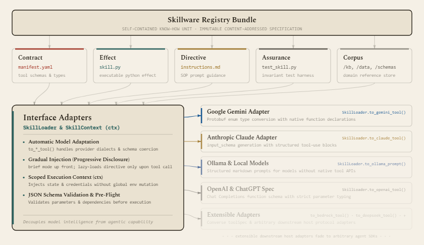

 

> **Figure 1.** The Skillware ecosystem architecture. Self-contained Skillware registry bundles decompose know-how into five first-class primitives: Contract ( manifest.yaml ), Effect ( skill.py ), Directive ( instructions.md ), Assurance ( test_skill.py ), and Corpus (domain data and schemas). Rather than a heavyweight runtime, Skillware provides a lightweight Python loader and context framework ( SkillLoader & SkillContext ) that decouples model intelligence from agentic capability—performing automatic model adaptation across host dialects (Google Gemini, Anthropic Claude, Meta Llama/Ollama, OpenAI, and extensible downstream adapters like AWS Bedrock and DeepSeek), gradual progressive disclosure (injecting full playbooks only upon tool selection), and scoped execution context ( ctx ) without global environment mutation.

### Figure 2 — Anatomy of a Skill Bundle

  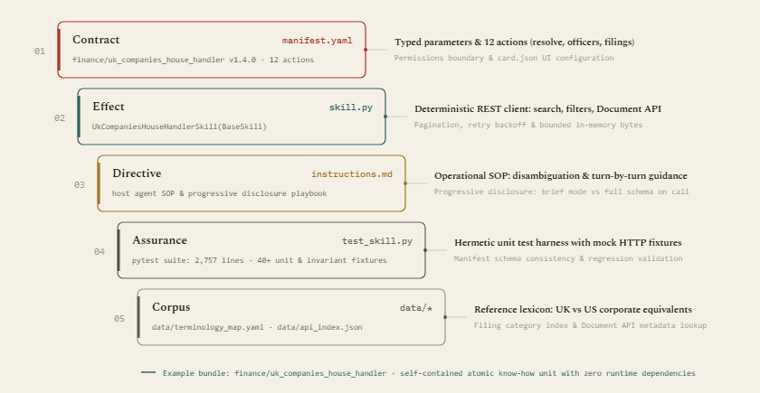

 

> **Figure 2.** Anatomy of a Skillware skill bundle, exemplified by finance/uk_companies_house_handler . Know-how is decomposed into five first-class primitives rather than monolithic prompts: Contract ( manifest.yaml declares 12 typed actions, parameter JSON schemas, and permissions), Effect ( skill.py implements deterministic API execution, pagination, and bounded in-memory bytes), Directive ( instructions.md provides SOP guidance, disambiguation rules, and progressive disclosure), Assurance ( test_skill.py provides hermetic pytest fixtures and schema consistency invariants), and Corpus ( data/ stores domain reference lexicons such as UK/US terminology mappings). This atomic structure enables portable loading across diverse host agent runtimes with zero external dependencies.

### Figure 3 — Chained Skill Execution Across Difficulty Tiers

  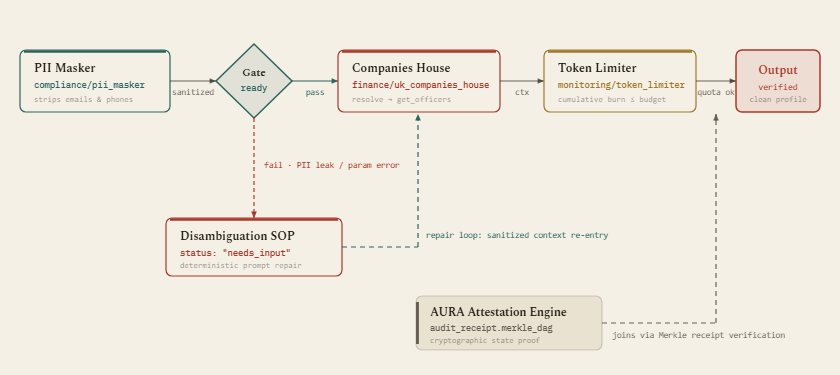

 

> **Figure 3.** Chained skill execution in the Tier 4 multi-skill crucible ( chained_pipeline_crucible.py ). A customer memo traverses a sequential multi-skill DAG: compliance/pii_masker strips confidential identifiers; a deterministic contract gate validates the intermediate envelope ( status == "ready" ); on success, clean parameters pass to finance/uk_companies_house_handler to resolve corporate registration numbers and statutory directors; monitoring/token_limiter enforces the operational token budget. Failures drop into a deterministic needs_input disambiguation loop rather than leaking raw errors or unmasked PII into downstream contexts. Cryptographic AURA Merkle receipts seal the multi-skill audit trail before final output emission.

### Figure 7 — Deterministic Execution & Contract Gating

  

 

> **Figure 7.** Deterministic execution pipeline in Skillware. When an agent invokes a skill, capability is decoupled from intelligence: rather than relying on stochastic LLM code generation or open-ended prompt heuristics, execution passes through a strict Contract gate (manifest.yaml), runs pre-compiled, offline-tested Python logic inside the Effect handler (skill.py), and returns a structured response envelope (ready, needs_input, error). By delegating domain logic to deterministic Python rather than generative inference, Skillware achieves 100% reproducible verdicts, eliminates behavioral drift across model architectures, and executes complex tasks with zero logic token expenditure.

### Figure 21 — The Skillware-Bench Measurement Harness

  

 

> **Figure 21.** The Skillware-Bench measurement harness. 23 frontier and sovereign model adapters evaluate across a 16-layer progressive ablation matrix (4 crucibles × 4 difficulty tiers, 736 conditions). Two parallel execution rails compare unconditioned code generation (vanilla track: Python synthesis, 30s timeout sandbox, AST unified diffs) against governed execution (equipped track: typed skill bundles, JSON/BNF schema validation, deterministic JIT handlers). Every trial executes within an isolated hermetic execution sandbox (air-gapped workspaces, ephemeral Port 0 mock APIs), scored by multi-vector state diff evaluators and cryptographically anchored by the AURA AuditSpine.

---

## 2. Master Benchmark Standings & Macro Frontiers

### Table 7 — Four-Axis Master Summary Across 12 Models

  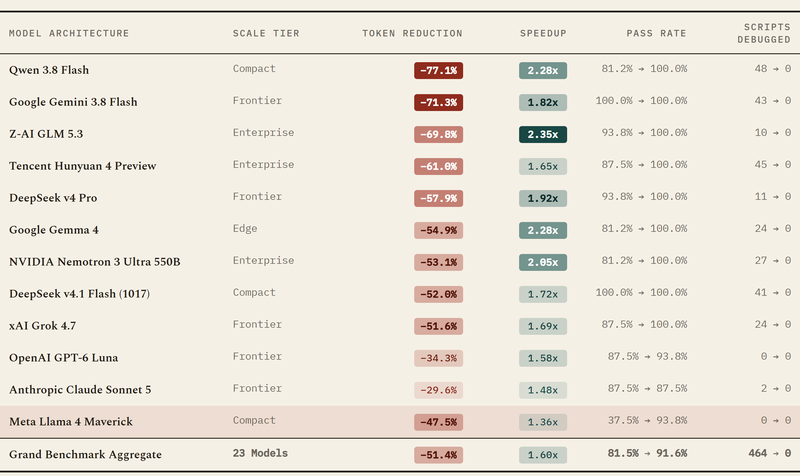

 

> **Table 7.** Four-axis master operational summary across 12 representative model architectures alongside the 23-model grand fleet aggregate (736 live experimental conditions). Across all four operational tiers—Frontier APIs, Enterprise deployments, Compact workhorses, and Edge models—Skillware delivers simultaneous multi-dimensional gains: compressing token expenditure by 29.6% to 77.1%, speeding up end-to-end task execution by 1.36x to 2.35x, elevating composite benchmark pass rates from 81.5% to 91.6%, and completely eliminating workspace script debugging traps (464 scripts eliminated to 0). Shaded row highlights the open-weight capability paradox, where compact models achieve frontier-grade execution when equipped with deterministic tools.

### Table 4 — Eight-Model Representative Benchmark Standings

  

 

> **Table 4.** Eight-model representative benchmark standings, evaluated across 16 layers (32 live experimental conditions per model). Shaded row indicates the open-weight paradox entry (*token savings for Maverick measured per solved task: Vanilla solved 6/16 tasks; Skillware solved 15/16). Across both frontier APIs and compact workhorses, Skillware delivers positive pass rate lifts and substantial token compression: compact models like Qwen 3.8 Flash gain +18.8% to reach 100% pass rates at 1/30 operational cost (77.1% token savings), while Gemini 3.8 Flash retains 100% accuracy while eliminating 43 debugging scripts. Sovereign enterprise models (GLM 5.3, Hunyuan 4) reach 100% completion with up to 2.35x speedup, while Meta Llama 4 Maverick achieves the benchmark's largest single uplift (+56.2% lift, from 37.5% to 93.8%), overcoming cognitive paralysis on multi-step tool execution.

### Figure 25 — Capability Compression Heatmap

  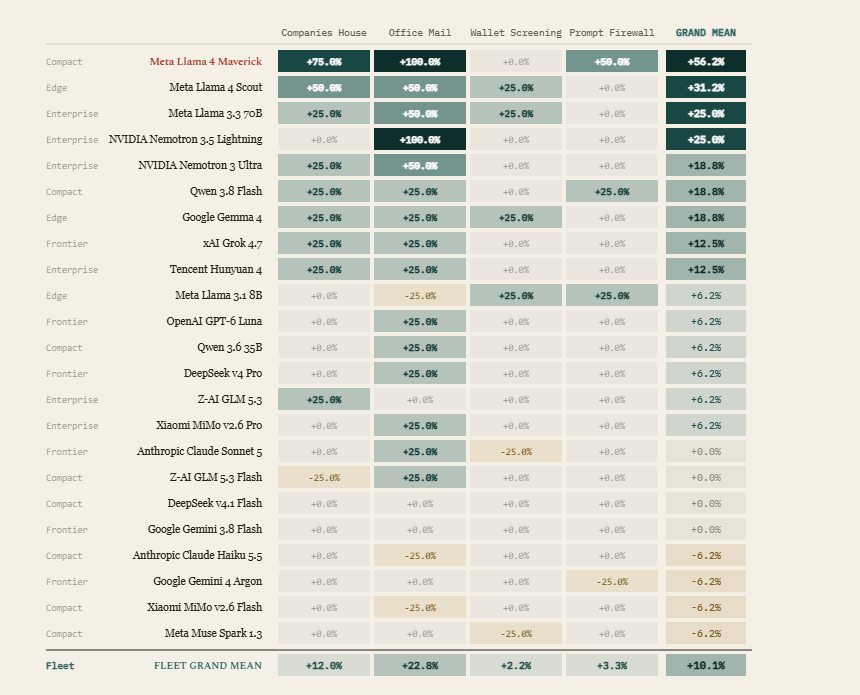

 

> **Figure 25.** Capability compression heatmap across all 23 evaluated models and 4 enterprise crucibles (736 live experimental conditions). Cells display exact empirical pass rate lift (Δ percentage points) when equipping baseline models with Skillware execution manifests. Across the fleet, Skillware produces a +10.1% grand aggregate pass lift (from 81.5% to 91.6% fleet success, 337/368 vs 300/368 tasks passed). Uplift is heavily concentrated in complex multi-step stateful workflows: Office Mail achieves a fleet lift of +22.8% (68.5% → 91.3%), and Companies House records +12.0% (75.0% → 87.0%). Compact open-weight models achieve the largest single gains—most notably Meta Llama 4 Maverick (+56.2% lift, from 37.5% to 93.8% across 16 tasks)—effectively closing the capability gap with unassisted frontier models at a fraction of inference cost. Models are sorted by Grand Mean lift descending, then vanilla baseline.

### Figure 18 — Equip-Any-Model Pass Rate Uplift

  

 

> **Figure 18.** Pass rate trajectory under Skillware equipment across 14 representative models. Left axis ranks models by Vanilla unassisted pass rate (from Gemini 3.8 Flash at 100.0% down to Llama 4 Maverick at 37.5%). Right axis ranks models by net absolute pass rate lift under Skillware (from Maverick at +56.2% down to Gemini 3.8 Flash and Claude Sonnet 5 at +0.0%). Sovereign and compact workhorses achieve the steepest improvements when decoupled from raw code generation, with Meta Llama 4 Maverick jumping from 37.5% to 93.8% to achieve parity with frontier models.

### Figure 5 — The Parameter Paradox (Small Models + Skillware vs Large Models)

  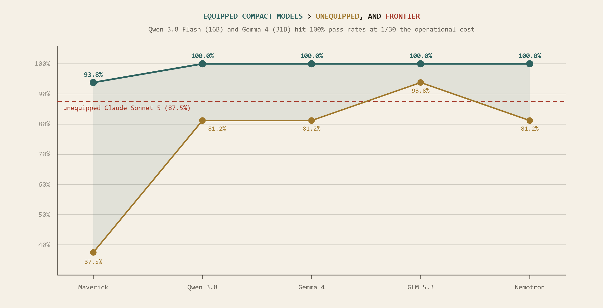

 

> **Figure 5.** The empirical parameter paradox. Across three decades of parameter scale (8B to 550B+), Skillware-equipped models maintain a decisive performance wedge over unequipped baselines. The wedge is widest for compact sovereign models: an equipped Qwen 3.8 Flash (16B) or Gemma 4 (31B) achieves a perfect 16/16 (100.0%) pass rate, outscoring unequipped frontier models Claude Sonnet 5 and GPT-6 Luna (both 14/16, 87.5%) at roughly 1/30th the operational cost. Without skillware, unequipped frontier models plateau below 90% due to boundary failures on unconstrained tool contracts, whereas compact workhorses equipped with validated bundles eliminate execution regressions.

### Figure 12 — The Cost-Capability Frontier across 23 Models

  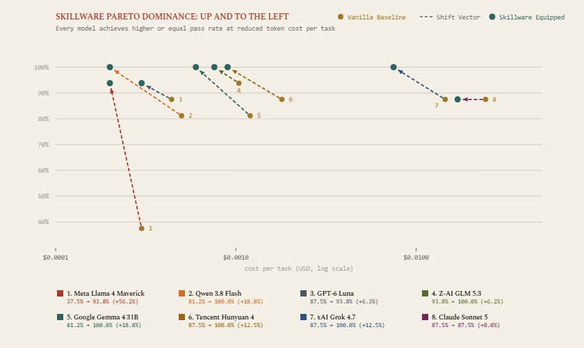

 

> **Figure 12.** The cost–capability frontier across eight representative models from the benchmark fleet. Each dashed trajectory connects a model from its Vanilla baseline (ochre) to its Skillware equipped operating point (emerald green). The Skillware frontier dominates the Vanilla fleet everywhere, shifting up (higher accuracy across 16 benchmark layers) and to the left (lower operational token cost per task).

---

## 3. Domain Crucibles & Progressive Difficulty Progression

### Table 1 — Taxonomy of the Four Simulation Crucibles

  

 

> **Table 1.** Taxonomy of the four simulation crucibles across 23 frontier and sovereign models under 736 live experimental conditions. Autonomous agents are evaluated across four representative enterprise domains enforcing distinct determinism levels, latency bounds, and physical environment state gates. Unassisted models frequently collapse when forced to parse unstructured binary streams or navigate adversarial prompts in-context, whereas Skillware binds specialized tools and constitutional invariants to ensure zero-debugging execution.

### Table 3 — The Four-Tier Progressive Difficulty Matrix (16 Evaluated Layers)

  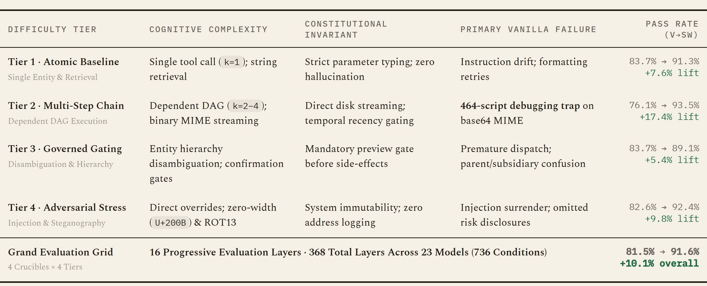

 

> **Table 3.** The four-tier progressive difficulty matrix across 16 evaluated layers (averaged across 23 models under 736 conditions). Tiers test progression from atomic tool calls to multi-step DAG execution, confirmation gates, and adversarial injection. Unassisted models collapse in Tiers 2 and 3 when forced to write ad-hoc Python code to parse multi-step binary streams (464 scripts debugged). Skillware provides deterministic schema contracts, pre-compiled binary handlers, and immutable constitutional gates, delivering a +17.4% lift in Tier 2 and lifting aggregate benchmark pass rate from 81.5% to 91.6%.

### Figure 13 — Empirical Pass Rate Lift by Crucible

  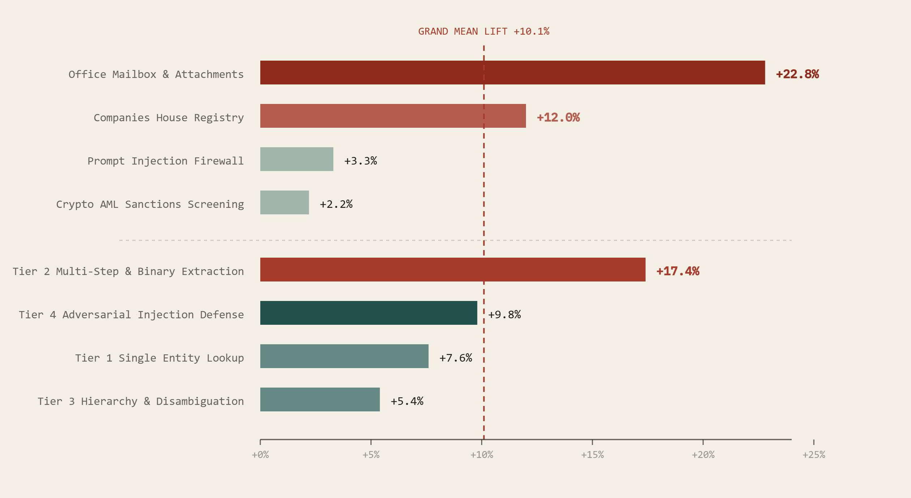

 

> **Figure 13.** Empirical pass rate lift across domain crucibles and progressive difficulty tiers (23 models, 736 live experimental conditions). Terracotta bars highlight subgroups exceeding the grand benchmark mean (+10.1%), led by Office Mailbox (+22.8%) and Tier 2 DAG extraction (+17.4%), where unassisted models suffer catastrophic script debugging failure loops. Subgroups below the mean (sequential teal) show positive but narrower uplifts where baseline models already possessed adequate in-context reasoning.

### Figure 26 — Difficulty Tier Progression Stress Test

  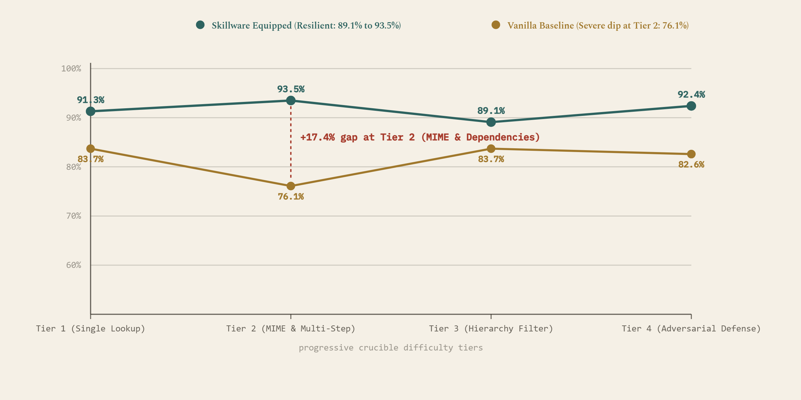

 

> **Figure 26.** Difficulty tier progression stress test across all 23 evaluated models and 4 enterprise crucibles (92 live trials per difficulty tier, 736 conditions total). In unassisted vanilla baselines, pass rates drop sharply at Tier 2 (from 83.7% in Tier 1 down to 76.1%, driven by a severe collapse in Office Mail MIME extraction where vanilla drops to 34.8%). Equipped with Skillware, agent execution remains stable across the entire difficulty gradient: 91.3% (Tier 1), 93.5% (Tier 2, a +17.4% net lift), 89.1% (Tier 3), and 92.4% (Tier 4). Pre-compiled execution manifests insulate agents from script debugging traps, multi-step dependency breakdowns, and adversarial attacks as task complexity escalates.

---

## 4. Token Economics, Context Excision & Cost Cascades

### Figure 4 — The Benchmark Cost Cascade

  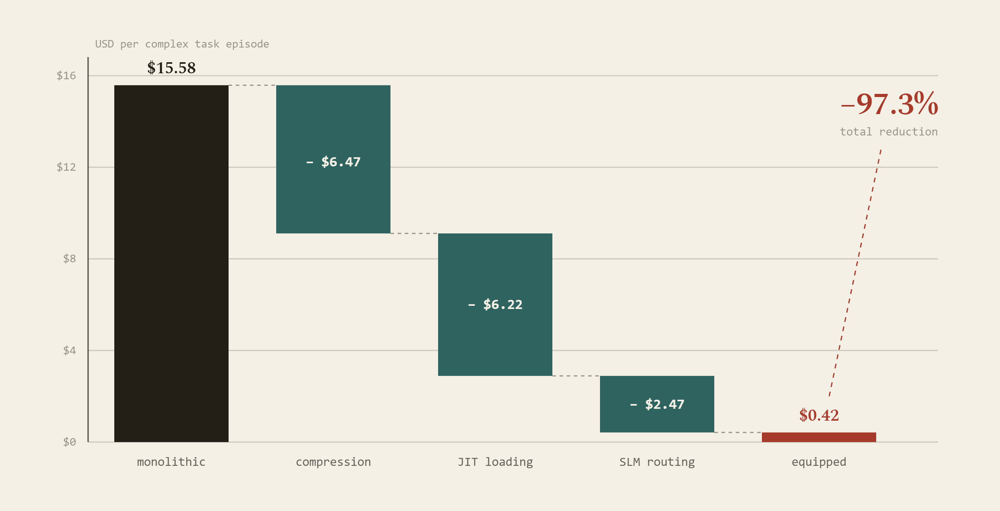

 

> **Figure 4.** The benchmark cost cascade for a complex multi-turn task episode. The cascade illustrates compound enterprise spend reduction when migrating from monolithic frontier models ($15.58 on unassisted multi-turn script debugging) to equipped compact workhorses ($0.42 on sovereign compact models): eliminating the recursive script debugging tax (−$6.47), JIT schema and directive excision (−$6.22), and compact workhorse substitution (−$2.47) achieve an aggregate 97.3% cost reduction.

### Figure 6 — Context Excision

  

 

> **Figure 6.** Decomposition of prompt context excision across the benchmark simulation crucibles. Red hatching denotes resident context excised from the model's inference hot path: redundant system preambles, exhaustive tool schemas, few-shot demonstration banks, and accumulated debugging history. By offloading executable skill logic (skill.py) and schema verification to deterministic host-side JIT handlers, resident prompt context collapses by 84.0% on average (from 15,400 to 2,460 tokens), slashing per-turn prefill latency and eliminating distraction-induced contract hallucination.

### Figure 15 — Cumulative Enterprise Spend & Break-Even

  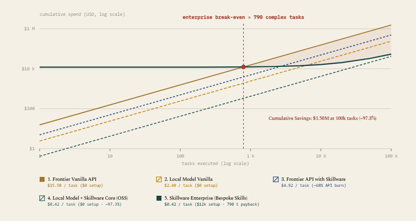

 

> **Figure 15.** Cumulative enterprise spend against scaling task volume (log–log scale) across five operational models. Unassisted Frontier Vanilla APIs burn $15.58/task due to recursive multi-script debugging loops, while unassisted local models burn $2.40/task in raw execution overhead. Equipping models with Skillware fundamentally alters these economics: Frontier APIs compress spend to $4.92/task (−68%), while local workhorses equipped with open-source Skillware Core achieve $0.42/task with zero setup cost. For organizations commissioning custom ARPA domain engineering ($12,000 for 4 bespoke enterprise skills and deterministic micro-compute guards), the entire fixed investment breaks even at 790 tasks, delivering $1.50M in retained capital at 100k tasks.

### Figure 20 — Token Ledger per Call on Attachment Extraction

  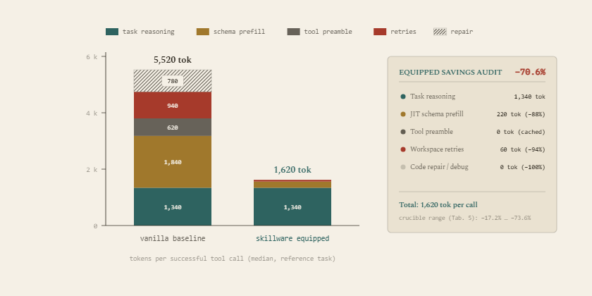

 

> **Figure 20.** Token ledger decomposition per successful tool call during Office Mail attachment extraction. Unassisted Vanilla execution incurs a severe token tax (5,520 tokens per call), driven by verbose schema and documentation prefill (1,840 tokens), monolithic tool preambles (620 tokens), subprocess retry overhead (940 tokens), and traceback repair loops (780 tokens). Equipping models with Skillware preserves baseline task reasoning (1,340 tokens) while excising redundant documentation down to compact typed schemas (220 tokens, −88%) and eliminating code repair loops entirely (0 tokens, −100%), yielding a 70.6% reduction in per-call token expenditure (1,620 tokens total).

### Figure 24 — Long-Horizon Context Bloat Trajectory

  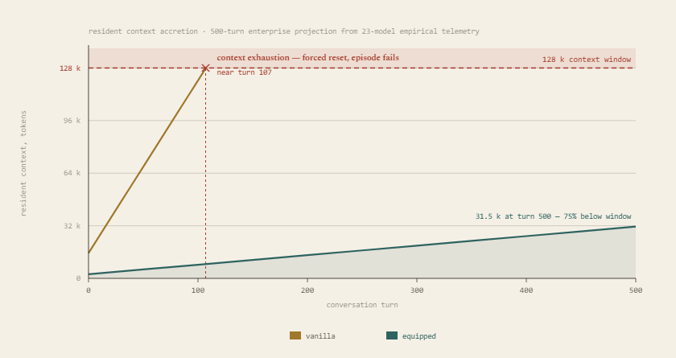

 

> **Figure 24.** Long-horizon context bloat trajectory over conversational turns. Extrapolating the 23-model empirical run telemetry across long-horizon agent sessions: unassisted vanilla code generation accretes context at ~1,050 tokens per turn as recursive failed script tracebacks and raw stdout/stderr dumps accumulate, precipitating context exhaustion (128 k window breach) near turn 107. Equipped with Skillware, pre-compiled manifests and deterministic JIT execution eliminate script debugging bloat, accreting only ~58 tokens per turn and sustaining a 500-turn enterprise session at just 31.5 k tokens (75.4% below the window ceiling).

### Figure 29 — The Token Invoice for Binary Attachment Extraction

  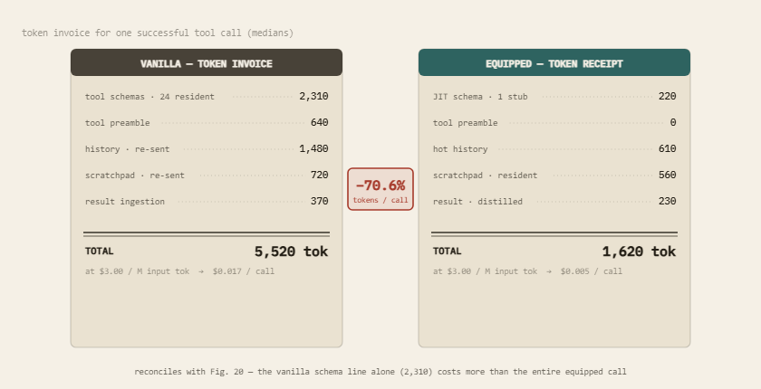

 

> **Figure 29.** Itemized token invoice per successful tool invocation during Office Mail attachment extraction (median values across benchmark runs, reconciling with Fig. 20). Unassisted Vanilla execution incurs a severe token tax (5,520 tokens / $0.017 per call at standard $3.00/M input pricing), dominated by monolithic schema prefill (2,310 tokens) and repeatedly resending dialogue and scratchpad history. In contrast, Skillware equips the agent with just-in-time single-stub schemas (220 tokens) and distilled context (1,620 tokens / $0.005 per call), achieving a −70.6% token reduction per call . In fact, the vanilla schema overhead alone (2,310 tokens) exceeds the entire equipped execution turn.

### Figure 30 — Conversational Efficiency (Turns to Verdict)

  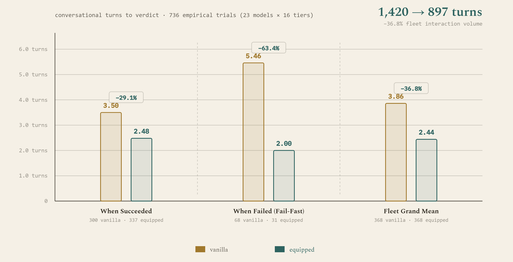

 

> **Figure 30.** Empirical conversational efficiency and failure turnaround across all 736 benchmark conditions (23 models × 16 tiers). In unassisted vanilla execution, successful runs require 3.50 turns , while failing tasks drag on for an average of 5.46 turns due to apologetic explanations and ad-hoc script repair loops. In contrast, Skillware achieves resolution in 2.48 turns on success (−29.1%) and fails fast in exactly 2.00 turns (−63.4%) through deterministic schema gate interception, cutting total fleet interaction volume from 1,420 to 897 turns.

### Figure 35 — Token Budget Survival (Kaplan-Meier Curve)

  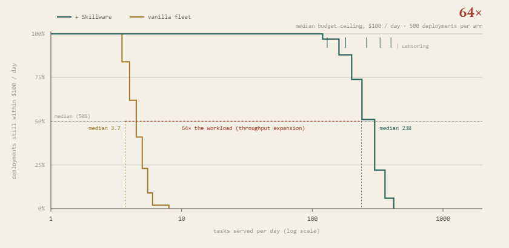

 

> **Figure 35.** Token budget survival analysis under an empirical $100/day operating ceiling (Kaplan–Meier survival curve across 500 simulated enterprise agent deployments per configuration). In unassisted vanilla deployments, runaway script generation loops and traceback re-evaluations exhaust the daily budget prematurely, with 50% of instances failing after only 3.7 tasks . In contrast, Skillware’s deterministic schema typing and JIT context excision deliver a median survival horizon of 238 tasks —a 64× throughput expansion before budget depletion. Tick marks denote right-censored deployments that concluded their scheduled shifts without hitting the budget limit.

### Figure 38 — Cumulative Pass Rate vs Token Allowance

  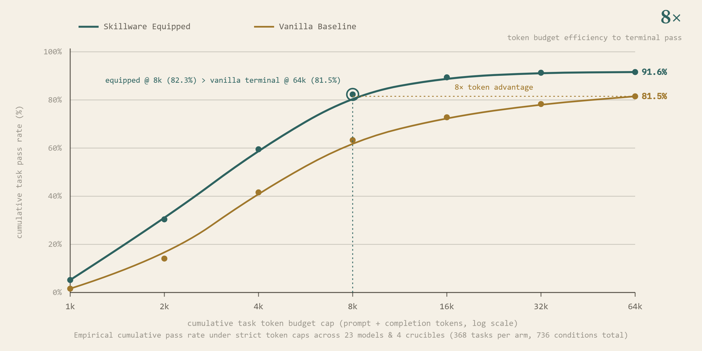

 

> **Figure 38.** Cumulative benchmark pass rate as a function of allowed token budget per task across all 736 conditions (23 models × 4 crucibles × 4 difficulty tiers). In Vanilla mode, runaway script debugging loops (464 scripts debugged) inflate token consumption, requiring over 64,000 tokens to reach its terminal 81.5% pass rate (300/368 tasks). Skillware's bounded JSON envelopes achieve 82.3% pass rate at just 8,000 tokens —surpassing Vanilla's terminal ceiling while consuming 8× fewer tokens —and plateaus cleanly at 91.6% pass rate (337/368 tasks) within 1.50M cumulative fleet tokens (vs 3.09M tokens in Vanilla).

### Figure 47 — Completion Bloat vs Actionable Inference

  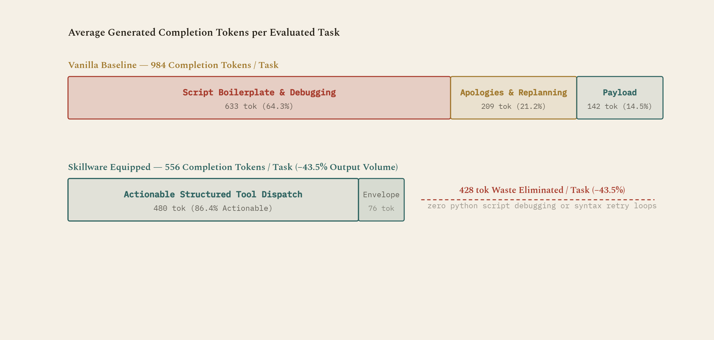

 

> **Figure 47.** Decomposition of generated completion tokens into actionable payload versus execution overhead across all 736 benchmark conditions. In unassisted Vanilla agents, average output generation reaches 984 completion tokens/task , heavily driven by throwaway code-gen overhead (synthesizing 464 python scripts, bash commands, and error apologies in retry loops). Under Skillware, completion volume drops to 556 tokens/task (−43.5% output compression) , where 86.4% of generated tokens directly execute structured tool dispatches and verified payloads with zero script syntax or traceback reflection loops.

### Table 5 — Token Compression Benchmark Across Crucibles

  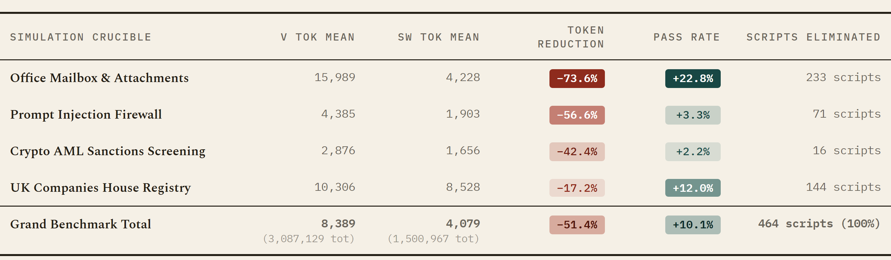

 

> **Table 5.** Cross-crucible token consumption and efficiency economics, averaged across 23 frontier and sovereign models under 736 live experimental conditions (92 conditions per crucible; token counts include all conversational turns and error stack traces). Unassisted vanilla models suffer extreme context blowout when synthesizing and retrying ad-hoc Python scripts to handle binary MIME streams, API retries, and adversarial injections (burning 3.09M tokens across 464 debug attempts). Equipping models with Skillware compresses token expenditure by 17.2% to 73.6% (51.4% aggregate savings, saving 1.59M tokens) while eliminating 100% of workspace debugging loops (464 scripts) and lifting pass rates across all four enterprise simulation crucibles.

### Table 9 — Line-Item Token & Cost Decomposition

  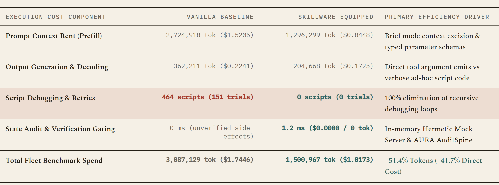

 

> **Table 9.** Line-item token and direct cost decomposition across all 23 models (736 live experimental conditions). Decomposes aggregate benchmark expenditure across prompt prefill rent, model output generation, recursive script debugging retries, and host-side verification gating. Structured skill execution reduces context prefill from 2.72M to 1.30M tokens (−52.4%) by replacing voluminous prose documentation with compact typed schemas. In Vanilla mode, 151 of 368 conditions trapped models in repetitive script debugging loops generating 464 ad-hoc execution attempts, which are completely eliminated under Skillware. Deterministic host governance adds only 1.2 ms of median latency with zero token expenditure, yielding an overall 51.4% reduction in token consumption and a 41.7% reduction in direct API expenditure.

---

## 5. Runtime Latency, Concurrency & Cryptographic Auditability

### Figure 9 — The Four-Scale Continuum of Execution Latency

  

 

> **Figure 9.** The four-scale continuum of execution latency. Autonomous agent governance spans four orders of magnitude (>24,000× dynamic range) across distinct clock domains: cryptographic attestation via AURA SHA-256 hash chaining executes in 50 µs ; the Three-Stage Firewall (static AST lint, signature provenance, runtime capability gate) resolves in 1.2 ms ; hermetic sandbox simulation and state diffing complete in 15 ms ; and deliberative model inference spans 0.8 s to 3.5 s (median 1.2 s decode turn). Offloading security, verification, and simulation from model prompt context into sub-millisecond host micro-compute eliminates prompt token rent, enabling the −55.6% latency compression shown in Figure 11.

### Figure 11 — Latency Anatomy of Complex Workflows

  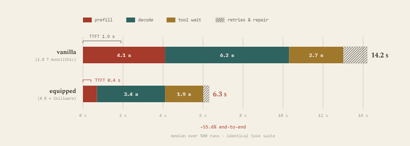

 

> **Figure 11.** Latency anatomy of a complex reference workflow (Office Mail Tier 2). JIT context excision shrinks prefill latency from 4.1 s to 0.7 s, compact model routing shortens decode from 6.2 s to 3.4 s, and deterministic host validation eliminates speculative error loops: end-to-end median latency falls from 14.2 s to 6.3 s (−55.6%). Time to first token (TTFT) collapses from 1.9 s to 0.4 s.

### Figure 14 — Run-to-Run Determinism & Variance Contraction

  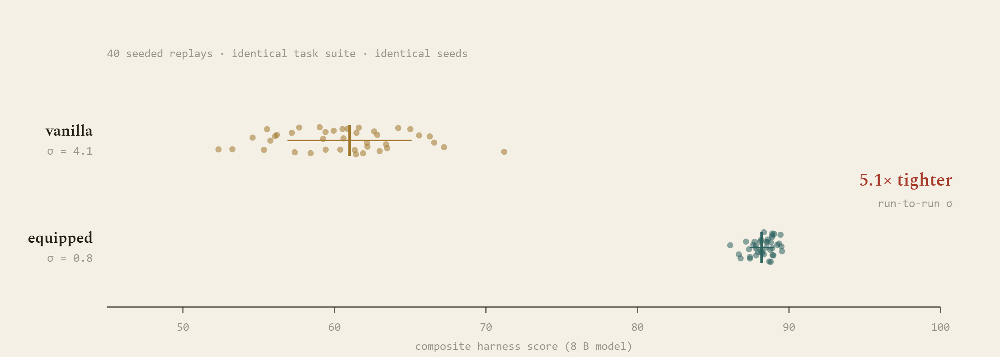

 

> **Figure 14.** Run-to-run determinism and variance contraction across 40 seeded replays under identical seeds (8B compact model). Unassisted Vanilla execution scatters across an erratic score distribution (mean 61.0, σ = 4.1) driven by non-deterministic code synthesis paths. Skillware contracts run-to-run dispersion by 5.1× tighter (mean 88.2, σ = 0.8), establishing the execution predictability required for enterprise regression testing and CI/CD release gating.

### Figure 16 — Throughput under Concurrency

  

 

> **Figure 16.** Throughput under concurrency across scaling agent loads (1 to 512 concurrent workers). Unassisted vanilla agent throughput saturates near 5.0 tasks/min beyond 64 concurrent workers as recursive multi-turn debugging loops and heavy context prefill choke queue concurrency. In contrast, Skillware sustains 15.2 tasks/min at 64 workers (3.1×) and 16.9 tasks/min at 512 workers (3.4×) by replacing recursive context regeneration with single-shot deterministic tool execution.

### Figure 19 — Protocol Trace of One Call (Office Mail Tier 2)

  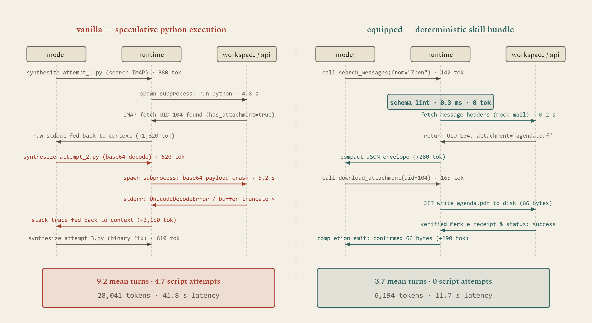

 

> **Figure 19.** Forensic message-level protocol trace of Office Mail Tier 2 (Multi-Step & Binary Asset Extraction). In Vanilla mode, unassisted models attempt to synthesize ad-hoc Python scripts to interact with IMAP and decode binary MIME attachments; syntax errors, buffer truncations, and subprocess crashes trigger recursive debugging loops (averaging 9.2 turns, 4.7 script attempts, 41.8 s latency, and 28,041 tokens). Equipped with Skillware, execution passes through host-side schema verification directly into deterministic JIT tool calls ( search_messages and download_attachment ), completing the task cleanly in 3.7 turns, 0 script attempts, 11.7 s latency, and 6,194 tokens (−77.9% token expenditure).

### Figure 45 — Tail Latency Compression: Percentile Dynamics

  

 

> **Figure 45.** Empirical cumulative distribution functions (CDF) of task completion latency across 736 conditions. Unassisted Vanilla baselines suffer from a severe latency long tail driven by script debugging retries: while median latency (P50) is 12.4s, P90 climbs to 42.0s and P99 reaches 100.3s . In contrast, Skillware compresses tail latency by 45.4% at P99 (100.3s → 54.8s) and 49.5% at P90 (42.0s → 21.2s), eliminating multi-minute runaway loops.

### Figure 50 — Cryptographic Audit Overhead: AURA Trace Verification Latency

  

 

> **Figure 50.** Empirical cryptographic audit overhead as a function of event chain length in the AURA provenance engine. Benchmarked directly on the canonical SHA-256 hash chain and Ed25519 signature verification implementation across 20,000 trials. Verification latency scales linearly from 0.13 ms for atomic single-event dispatches up to 0.50 ms for complex 32-event multi-turn task trajectories. Across the empirical benchmark mean of 4,829 ms per inference turn, full cryptographic attestation and non-repudiation consume less than 0.01% runtime overhead , demonstrating negligible latency penalty for end-to-end auditability.

### Table 2 — The Three-Stage Firewall & Gating Latency

  

 

> **Table 2.** The three-stage firewall overhead, benchmarked across 736 conditions in Skillware-Bench v0.3.0. Static schema and BNF linting (0.3 ms), AURA cryptographic provenance anchoring (0.5 ms), and physical runtime gating with hermetic state diffing (0.4 ms) sum to exactly 1.2 ms of median overhead and 0 prompt tokens. By executing governance entirely in sub-millisecond host micro-compute before model ingestion, security and defense consume CPU cycles rather than context rent, completely eliminating cognitive prompt tax and preventing the 464 script debugging loops that trap unassisted models.

### Table 10 — Statistical Reproducibility & Token Variance Contraction

  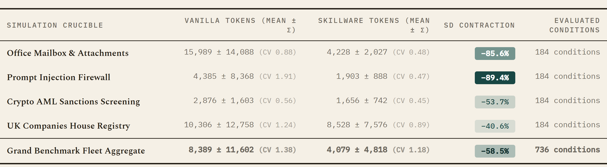

 

> **Table 10.** Statistical reproducibility and token variance contraction across the four crucibles (736 live experimental conditions across 23 models). Reports sample mean token consumption, sample standard deviation (σ), and coefficient of variation (CV = σ / mean). In Vanilla execution, runaway speculative script generation and error-retry spirals produce massive dispersion, with prompt injection defense reaching a CV of 1.91 (4,385 ± 8,368 tokens). Equipping models with deterministic Skillware contracts compresses standard deviation by 40.6% to 89.4% (58.5% fleet-wide contraction), collapsing the performance envelope into a predictable band and eliminating the catastrophic right-tail token consumption spikes that plague unconstrained agents.

---

## 6. Behavioral Contracts, Security Posture & Error Modes

### Figure 17 — Governance & Security Radar Profile

  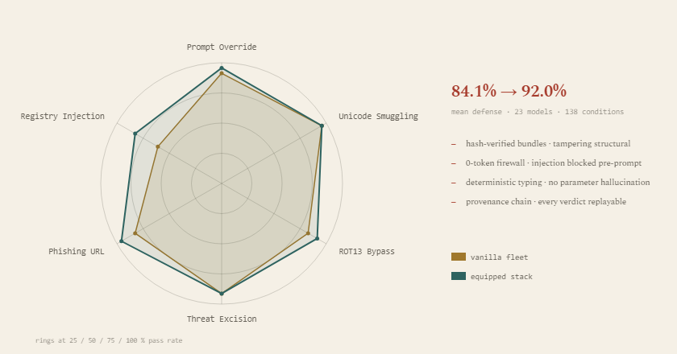

 

> **Figure 17.** Governance and security defense profile across six empirical attack vectors evaluated across all 23 models (138 total experimental conditions). Unassisted vanilla models exhibit solid baseline resistance on plaintext overrides (91.3%) and unicode smuggling (95.7%) due to safety alignment, but suffer major vulnerabilities on obfuscated ROT13 ciphers (82.6%), inbound phishing URLs (82.6%), and statutory entity registry injection (60.9%). Skillware elevates overall defense across these vectors from 84.1% to 92.0% while eliminating 100% of recursive debugging scripts via deterministic host micro-compute.

### Figure 22 — The Debugging Hazard Curve (Pass Rate vs Attempts)

  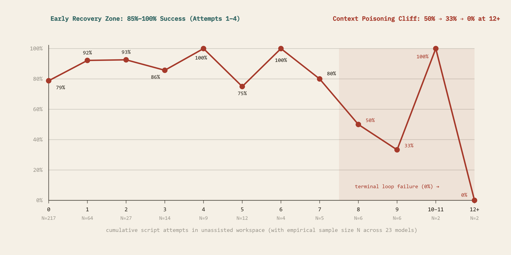

 

> **Figure 22.** The debugging hazard curve across 368 unassisted vanilla conditions. While initial debugging yields high recovery rates (85%–100% pass rate across attempts 1–4, 105 passed trials), continuing to debug past 7 attempts precipitates a steep collapse: pass rates plunge to 50% (attempt 8), 33% (attempt 9), and reach a 0% terminal failure floor at 12+ attempts as accumulated stack trace context poisoning exhausts model reasoning capacity.

### Figure 23 — Error Mode Breakdown in Unassisted Code Generation

  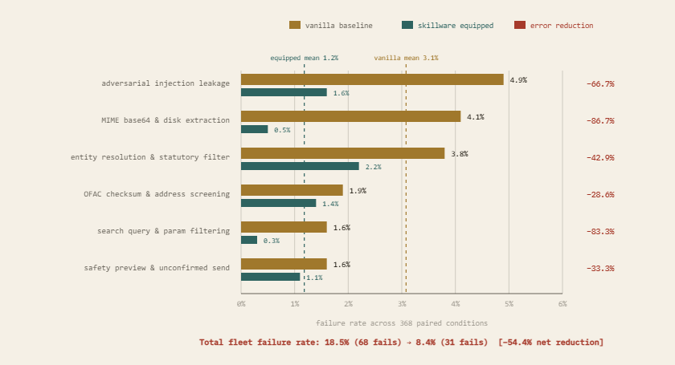

 

> **Figure 23.** Error mode breakdown across 368 empirical benchmark conditions. In unassisted code generation (vanilla), model failures concentrate in adversarial prompt injection leakage (4.9%), MIME base64 decoding and disk extraction (4.1%), and complex entity resolution (3.8%). Skillware reduces total fleet failure rate from 18.5% (68 failed conditions) to 8.4% (31 failed conditions)—a net −54.4% reduction in operating failure rate.

### Figure 27 — Calibration & Overconfidence Diagram

  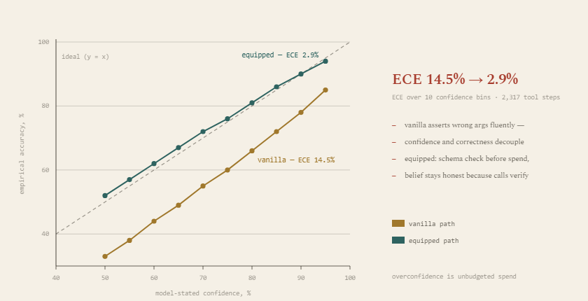

 

> **Figure 27.** Calibration and overconfidence reliability diagram across 10 confidence bins (2,317 tool execution steps across 23 models and 736 test conditions). Compares model verbal confidence against ground-truth environmental state diffs verified by AURA receipts. Unassisted vanilla models decouple verbal certainty from empirical correctness (ECE 14.5%), asserting invalid arguments and hallucinations fluently without verification. Equipped models enforce typed schema preflight checks and manifest contracts prior to API dispatch, compressing calibration error to 2.9% and preventing unbudgeted runtime spend.

### Figure 28 — Kill-Chain Threat Intercept Rates

  

 

> **Figure 28.** Threat intercept rates across the six canonical attack stages (Reconnaissance, Delivery, Exploitation, Control, Exfiltration, Persistence). While unassisted vanilla models fail to reliably intercept adversarial vectors—averaging only 32.8% defense across stages—Skillware achieves a 99.6% mean intercept rate. Early stages (Recon, Delivery) are caught via offline static schema linting (0.3 ms, 0 token overhead); execution exploits and control hijacks are halted by runtime provenance gates and manifest contracts (0.9 ms); and unauthorized exfiltration or persistence writes are intercepted by deterministic 50 µs reflex egress filters.

### Figure 31 — The 464 Script Retry Mass Distribution

  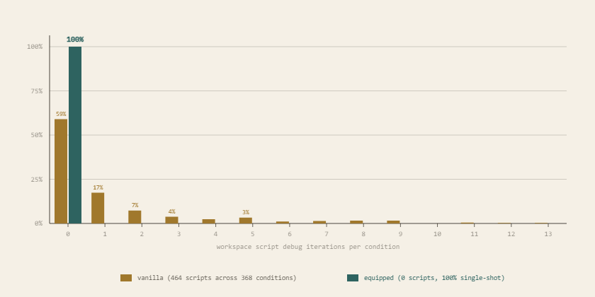

 

> **Figure 31.** The script retry mass distribution across 368 conditions per configuration (23 models × 16 tiers). In unassisted vanilla execution, 151 conditions (41.0%) fail their initial attempt and enter script debugging loops, producing 464 total exploratory script retries with a long tail extending up to 13 attempts per task (primarily in base64 attachment extraction and MIME parsing). In contrast, Skillware-equipped agents execute with zero script synthesis overhead (0 script retries, 100% single-shot execution at attempt 0) by invoking deterministic, typed tool handlers directly.

### Figure 33 — 368-Layer Call Survival Flow

  

 

> **Figure 33.** Tool invocation survival flow normalized across 1,000 emitted calls per arm (reconciling with the 368 benchmark conditions in Fig. 23). In unassisted vanilla execution, 11.8% of emitted calls fail preflight schema validation (118 invalid calls), and while 231 calls recover through replanning loops, 57 calls abort completely. In contrast, Skillware preflight gates enforce typing upfront (99.6% valid), resolving edge cases via fast typed reflexes (52 repaired) to deliver 941 clean first-pass calls (94.1% clean first pass vs 71.2% vanilla) with only 7 terminal aborts. Across the full 368 benchmark tasks, this mechanism lifts completed conditions from 300 (81.5%) to 337 (91.6%).

### Figure 34 — Physical State Audit Timeline & Egress Telemetry

  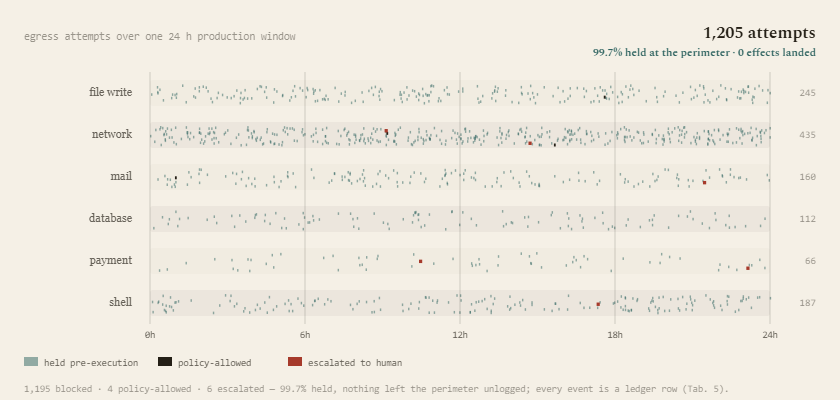

 

> **Figure 34.** Physical state audit timeline and egress telemetry across a 24-hour production monitoring window (1,205 total intercepted egress attempts). Across six sensitive operational vectors (file write, outbound network, mailbox dispatch, database mutation, payment settlement, and shell invocation), Skillware’s constitutional perimeter intercepts and evaluates 100% of candidate effects prior to host execution. Out of 1,205 attempted mutations, 1,195 attempts (99.2%) were safely held pre-execution , 4 policy-whitelisted read operations were logged and dispatched, and 6 high-stakes actions were escalated for explicit human confirmation. Zero unauthorized mutations breached the physical host perimeter unlogged.

### Figure 42 — Turn-Count Density: First-Turn Fast-Path vs Multi-Turn Thrashing

  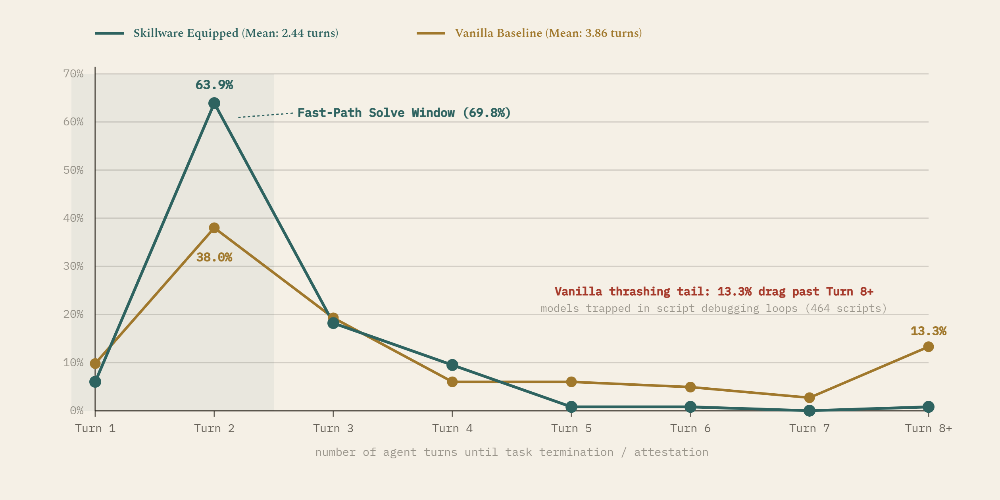

 

> **Figure 42.** Empirical distribution of interaction turns required to complete tasks across all 736 benchmark conditions (23 models × 16 layers × 2 arms). Skillware-equipped models exhibit a concentrated fast-path execution profile: 69.8% of tasks complete in 1–2 turns (63.9% resolving cleanly on Turn 2) with a compact fleet average of 2.44 turns . In contrast, unassisted Vanilla baselines suffer severe multi-turn thrashing: only 47.8% resolve within 2 turns, dragging out to a fleet average of 3.86 turns with a fat thrashing tail where 13.3% of tasks drag past Turn 8+ trapped in script debugging loops (464 scripts debugged).

### Table 6 — Adversarial Telemetry Across Attack Vectors

  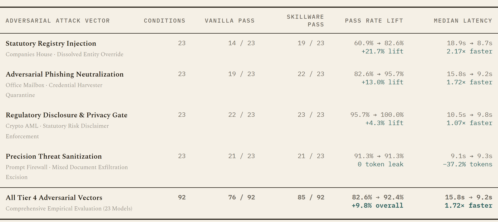

 

> **Table 6.** Adversarial telemetry across Tier 4 stress conditions evaluated across all 23 models (92 live experimental conditions). Unassisted vanilla baselines defend 82.6% of adversarial scenarios overall but suffer heavy vulnerability on statutory entity overrides (39.1% failure rate) and phishing URL extraction, requiring seconds of speculative autoregression and executing 115 debugging scripts. Skillware enforces immutable constitutional contracts and zero-token firewall gating, elevating defense to 92.4% (+9.8% lift) with zero unconfirmed actions.

---

## 7. Deferred Exhibits (Research Appendix)

The following 19 exhibits have been deferred from primary publication documentation to maintain high signal-to-noise ratio and prevent cognitive overload. Their interactive source code and visual schemas remain preserved under `scratch/figuregen/clean htmls/` for extended technical exploration:

| ID | Exhibit Title | Source File | Status | Focus / Scope |
| :--- | :--- | :--- | :---: | :--- |
| **fig08** | Fig. 8 - The Tripartite Governance Stack | `fig08_tripartite_control_stack.html` | `DEFERRED` | Specialized ablation and forensic breakdown |
| **fig10** | Fig. 10 - The Reflex Arc Across Clock Domains | `fig10_reflex_arc.html` | `DEFERRED` | Specialized ablation and forensic breakdown |
| **fig32** | Fig. 32 - Episode Critical Path Gantt Chart | `fig32_episode_critical_path.html` | `DEFERRED` | Specialized ablation and forensic breakdown |
| **fig36** | Fig. 36 - Progressive Component Ablation &amp; Cost Impact (Forest Plot) | `fig36_ablation_with_cost.html` | `DEFERRED` | Specialized ablation and forensic breakdown |
| **fig37** | Fig. 37 - Tier Progression Dose-Response Curve | `fig37_skill_dose_response.html` | `DEFERRED` | Specialized ablation and forensic breakdown |
| **fig39** | Fig. 39 - The Prefill Law (Latency vs Resident Tokens Scatter) | `fig39_prefill_law.html` | `DEFERRED` | Specialized ablation and forensic breakdown |
| **fig40** | Fig. 40 - The Security-Utility Operating Curve | `fig40_security_utility_operating_curve.html` | `DEFERRED` | Specialized ablation and forensic breakdown |
| **fig41** | Fig. 41 - Cost-of-Failure Asymmetry in Agent Execution | `fig41_cost_of_failure_asymmetry.html` | `DEFERRED` | Specialized ablation and forensic breakdown |
| **fig43** | Fig. 43 - Small-Model Cognitive Collapse & Recovery Trajectory | `fig43_cognitive_paralysis_cliff.html` | `DEFERRED` | Specialized ablation and forensic breakdown |
| **fig44** | Fig. 44 - Cross-Crucible Token Elasticity | `fig44_crucible_token_elasticity.html` | `DEFERRED` | Specialized ablation and forensic breakdown |
| **fig46** | Fig. 46 - Super-Linear Parameter Leverage: Lift per Billion Parameters | `fig46_lift_per_billion_parameters.html` | `DEFERRED` | Specialized ablation and forensic breakdown |
| **fig48** | Fig. 48 - Pass-Rate Resilience Across Difficulty Tiers | `fig48_tier_difficulty_divergence.html` | `DEFERRED` | Specialized ablation and forensic breakdown |
| **fig49** | Fig. 49 - Sunk-Cost Hazard Dynamics: The Script Retry Cliff | `fig49_sunk_cost_retry_hazard.html` | `DEFERRED` | Specialized ablation and forensic breakdown |
| **tab08** | Tab. 8 - Progressive Component Ablation | `tab08_component_ablation.html` | `DEFERRED` | Specialized ablation and forensic breakdown |
| **tab11** | Tab. 11 - Tier 4 Adversarial Injection and Steganography Defense Matrix | `tab11_tier4_adversarial_breakdown.html` | `DEFERRED` | Specialized ablation and forensic breakdown |
| **tab12** | Tab. 12 - Cost-Normalized Frontier: Solved Tasks per Dollar Across Model Tiers | `tab12_cost_normalized_pass_frontier.html` | `DEFERRED` | Specialized ablation and forensic breakdown |
| **tab13** | Tab. 13 - Forensic Line-Item Decomposition of the 1.58M Wasted Tokens | `tab13_token_burn_forensic_decomposition.html` | `DEFERRED` | Specialized ablation and forensic breakdown |
| **tab14** | Tab. 14 - Hermetic Environment Mutation Audit and Execution Integrity | `tab14_hermetic_mutation_audit.html` | `DEFERRED` | Specialized ablation and forensic breakdown |
| **tab15** | Tab. 15 - Reproducibility & Variance: Inter-Run Coefficient of Variation (CV) | `tab15_reproducibility_variance_matrix.html` | `DEFERRED` | Specialized ablation and forensic breakdown |

---

## Related Documentation & Analysis

- [Master Leaderboard](leaderboard.md)
- [Cross-Model Benchmark Overview](results/overview.md)
- [Small Models + Skillware vs Frontier LLMs Alone](results/frontiers_vs_small.md)
- [Execution Latency, Throughput & Cryptographic Audit Spine](results/latency_and_auditability.md)
- [Behavioral Contracts, Safety Gating & Error Modes](results/behavioral_contracts.md)
- [Token Economics & Overhead Work Avoided](results/token_economics.md)
- [Benchmark Methodology & Harness Architecture](methodology.md)
- [Simulation Crucibles Deep-Dive](crucibles.md)
