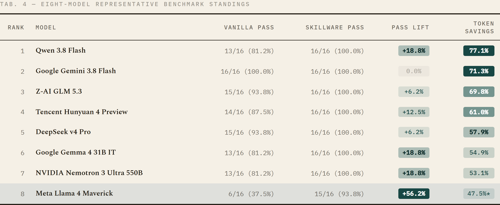
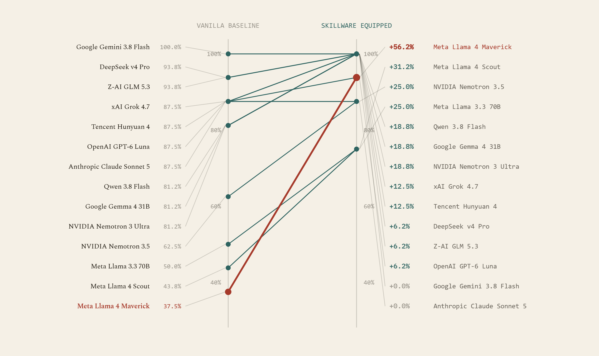

# Skillware-Bench Leaderboard

Empirical performance evaluation across 23 sovereign and frontier models executing governed Skillware skills under the 16-layer Progressive Tiered Ablation Benchmark.

---

> For complete cross-model tables, metric comparisons, and capability tier breakdowns, see the [Cross-Model Benchmark Overview](results/overview.md).

## Master Benchmark Standings (All 23 Models)

| Rank | Model Architecture | Capability Tier | Vanilla Pass | Skillware Pass | Pass Lift | Token Savings | Speedup | Vanilla Scripts | Model Card |
| :---: | :--- | :--- | :---: | :---: | :---: | :---: | :---: | :---: | :--- |
| **1** | [Qwen 3.8 Flash](results/models/qwen_qwen3_8_flash.md) | Compact | 13/16 | **16/16** | +18.8% | 77.1% | 2.28x | 48 | [Card](results/models/qwen_qwen3_8_flash.md) |
| **2** | [Google Gemini 3.8 Flash](results/models/google_gemini_3_8_flash.md) | Compact | 16/16 | **16/16** | +0.0% | 71.3% | 1.82x | 43 | [Card](results/models/google_gemini_3_8_flash.md) |
| **3** | [Z-AI GLM 5.3](results/models/zai_glm_5_3.md) | Enterprise | 15/16 | **16/16** | +6.2% | 69.8% | 2.35x | 10 | [Card](results/models/zai_glm_5_3.md) |
| **4** | [Tencent Hunyuan 4 Preview](results/models/tencent_hy4_preview.md) | Enterprise | 14/16 | **16/16** | +12.5% | 61.0% | 1.65x | 45 | [Card](results/models/tencent_hy4_preview.md) |
| **5** | [DeepSeek v4 Pro](results/models/deepseek_v4_pro.md) | Frontier | 15/16 | **16/16** | +6.2% | 57.9% | 1.92x | 11 | [Card](results/models/deepseek_v4_pro.md) |
| **6** | [Google Gemma 4 31B IT](results/models/google_gemma_4_31b_it.md) | Edge | 13/16 | **16/16** | +18.8% | 54.9% | 2.28x | 24 | [Card](results/models/google_gemma_4_31b_it.md) |
| **7** | [NVIDIA Nemotron 3 Ultra 550B](results/models/nvidia_nemotron_3_ultra_550b.md) | Enterprise | 13/16 | **16/16** | +18.8% | 53.1% | 2.05x | 27 | [Card](results/models/nvidia_nemotron_3_ultra_550b.md) |
| **8** | [Qwen 3.6 35B A3B](results/models/qwen_qwen3_6_35b_a3b.md) | Compact | 15/16 | **16/16** | +6.2% | 52.4% | 1.79x | 16 | [Card](results/models/qwen_qwen3_6_35b_a3b.md) |
| **9** | [DeepSeek v4.1 Flash (1017)](results/models/deepseek_v4_1_flash_1017.md) | Compact | 16/16 | **16/16** | +0.0% | 52.0% | 1.72x | 41 | [Card](results/models/deepseek_v4_1_flash_1017.md) |
| **10** | [xAI Grok 4.7](results/models/xai_grok_4_7.md) | Frontier | 14/16 | **16/16** | +12.5% | 51.6% | 1.69x | 24 | [Card](results/models/xai_grok_4_7.md) |
| **11** | [Xiaomi MiMo v2.6 Pro](results/models/xiaomi_mimo_v2_6_pro.md) | Enterprise | 15/16 | **16/16** | +6.2% | 29.2% | 0.66x | 36 | [Card](results/models/xiaomi_mimo_v2_6_pro.md) |
| **12** | [Meta Muse Spark 1.3](results/models/meta_muse_spark_1_3.md) | Compact | 16/16 | **15/16** | -6.2% | 66.5% | 1.86x | 41 | [Card](results/models/meta_muse_spark_1_3.md) |
| **13** | [OpenAI GPT-6 Luna](results/models/openai_gpt_6_luna.md) | Frontier | 14/16 | **15/16** | +6.2% | 34.3% | 1.58x | 0 | [Card](results/models/openai_gpt_6_luna.md) |
| **14** | [Xiaomi MiMo v2.6 Flash](results/models/xiaomi_mimo_v2_6_flash.md) | Compact | 16/16 | **15/16** | -6.2% | 33.3% | 1.26x | 7 | [Card](results/models/xiaomi_mimo_v2_6_flash.md) |
| **15** | [Z-AI GLM 5.3 Flash](results/models/zai_glm_5_3_flash.md) | Compact | 15/16 | **15/16** | +0.0% | 22.2% | 1.53x | 25 | [Card](results/models/zai_glm_5_3_flash.md) |
| **16** | [Google Gemini 4 Argon](results/models/google_gemini_4_argon.md) | Frontier | 16/16 | **15/16** | -6.2% | 10.4% | 1.33x | 16 | [Card](results/models/google_gemini_4_argon.md) |
| **17** | [Meta Llama 4 Maverick](results/models/meta_llama_4_maverick.md) | Compact | 6/16 | **15/16** | +56.2% | -31.4% | 1.36x | 0 | [Card](results/models/meta_llama_4_maverick.md) |
| **18** | [NVIDIA Nemotron 3.5 Lightning](results/models/nvidia_nemotron_3_5_lightning.md) | Compact | 10/16 | **14/16** | +25.0% | 57.3% | 2.53x | 21 | [Card](results/models/nvidia_nemotron_3_5_lightning.md) |
| **19** | [Anthropic Claude Haiku 5.5](results/models/anthropic_claude_haiku_5_5.md) | Compact | 15/16 | **14/16** | -6.2% | 32.0% | 1.55x | 16 | [Card](results/models/anthropic_claude_haiku_5_5.md) |
| **20** | [Anthropic Claude Sonnet 5](results/models/anthropic_claude_sonnet_5.md) | Frontier | 14/16 | **14/16** | +0.0% | 29.6% | 1.48x | 2 | [Card](results/models/anthropic_claude_sonnet_5.md) |
| **21** | [Meta Llama 3.3 70B Instruct](results/models/meta_llama_3_3_70b_instruct.md) | Enterprise | 8/16 | **12/16** | +25.0% | 42.6% | 2.05x | 10 | [Card](results/models/meta_llama_3_3_70b_instruct.md) |
| **22** | [Meta Llama 4 Scout](results/models/meta_llama_4_scout.md) | Edge | 7/16 | **12/16** | +31.2% | -69.1% | 1.20x | 1 | [Card](results/models/meta_llama_4_scout.md) |
| **23** | [Meta Llama 3.1 8B Instruct](results/models/meta_llama_3_1_8b_instruct.md) | Edge | 4/16 | **5/16** | +6.2% | 56.7% | 2.44x | 0 | [Card](results/models/meta_llama_3_1_8b_instruct.md) |

*Full cross-model analyses, tier breakdowns, and aggregate statistics are detailed in the [Cross-Model Benchmark Overview](results/overview.md).*

---

## Benchmark Standings & Trajectories

  

> **Table 4.** Eight-model representative benchmark standings, evaluated across 16 layers (32 live experimental conditions per model). Shaded row indicates the open-weight paradox entry (*token savings for Maverick measured per solved task: Vanilla solved 6/16 tasks; Skillware solved 15/16). Across both frontier APIs and compact workhorses, Skillware delivers positive pass rate lifts and substantial token compression: compact models like Qwen 3.8 Flash gain +18.8% to reach 100% pass rates at 1/30 operational cost (77.1% token savings), while Gemini 3.8 Flash retains 100% accuracy while eliminating 43 debugging scripts. Sovereign enterprise models (GLM 5.3, Hunyuan 4) reach 100% completion with up to 2.35x speedup, while Meta Llama 4 Maverick achieves the benchmark's largest single uplift (+56.2% lift, from 37.5% to 93.8%), overcoming cognitive paralysis on multi-step tool execution.

  

> **Figure 18.** Pass rate trajectory under Skillware equipment across 14 representative models. Left axis ranks models by Vanilla unassisted pass rate (from Gemini 3.8 Flash at 100.0% down to Llama 4 Maverick at 37.5%). Right axis ranks models by net absolute pass rate lift under Skillware (from Maverick at +56.2% down to Gemini 3.8 Flash and Claude Sonnet 5 at +0.0%). Sovereign and compact workhorses achieve the steepest improvements when decoupled from raw code generation, with Meta Llama 4 Maverick jumping from 37.5% to 93.8% to achieve parity with frontier models.

---

## Related Analyses & Catalogs

- [Cross-Model Benchmark Overview](results/overview.md)
- [Complete Benchmark Exhibits Catalog](exhibits.md)
- [Small Models + Skillware vs. Frontier LLMs Alone](results/frontiers_vs_small.md)
- [Execution Latency, Throughput & Cryptographic Audit Spine](results/latency_and_auditability.md)
- [Behavioral Contracts, Safety Gating & Error Modes](results/behavioral_contracts.md)
- [Token Economics & Overhead Work Avoided](results/token_economics.md)
- [Individual Model Cards](results/models/)
