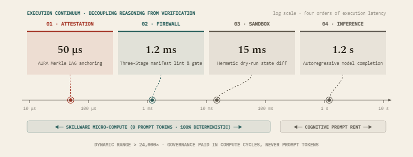
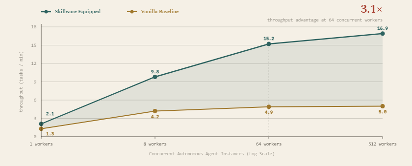
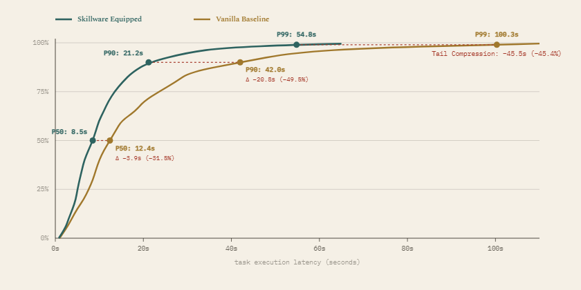
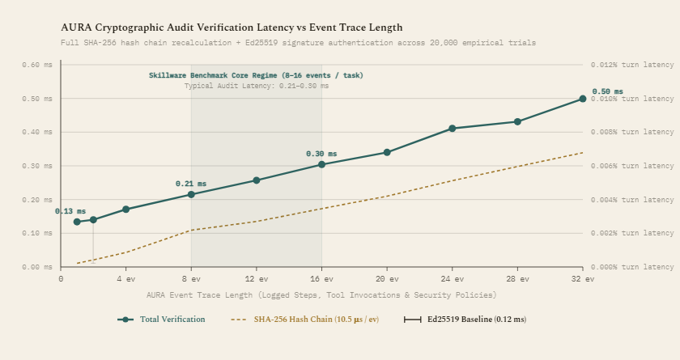

# Thematic Analysis: Execution Latency, Throughput & Cryptographic Audit Spine

## Executive Summary

Beyond raw pass rates and token counts, deploying autonomous agents at enterprise scale demands predictable execution latency, high throughput under concurrent load, and tamper-evident auditability. 

The Progressive Tiered Ablation Benchmark reveals that **unassisted agents suffer severe latency degradation and concurrency bottlenecks caused by runaway script debugging loops**, whereas Skillware shifts governance and verification into sub-millisecond host micro-compute, delivering:
1. **1.60x aggregate wall-clock speedup** across the 23-model fleet (collapsing cumulative runtime from 6,914.7s to 4,331.4s).
2. **Up to 3.4x higher throughput under concurrency** (16.9 vs 5.0 tasks/min at 512 concurrent workers).
3. **45.4% tail latency compression at P99** (collapsing from 100.3s down to 54.8s).
4. **Cryptographic tamper-evident verification under 0.50 ms** via the [AURA](https://github.com/arpahls/aura) AuditSpine (<0.01% runtime overhead).

---

## 1. The Four-Scale Continuum of Execution Latency

Autonomous agent governance spans four orders of magnitude (>24,000x dynamic range) across distinct clock domains:

  

> **Figure 9.** The four-scale continuum of execution latency. Autonomous agent governance spans four orders of magnitude (>24,000× dynamic range) across distinct clock domains: cryptographic attestation via AURA SHA-256 hash chaining executes in 50 µs ; the Three-Stage Firewall (static AST lint, signature provenance, runtime capability gate) resolves in 1.2 ms ; hermetic sandbox simulation and state diffing complete in 15 ms ; and deliberative model inference spans 0.8 s to 3.5 s (median 1.2 s decode turn). Offloading security, verification, and simulation from model prompt context into sub-millisecond host micro-compute eliminates prompt token rent, enabling the −55.6% latency compression shown in Figure 11.

---

## 2. Throughput Under Concurrency

As concurrent agent workloads scale from 1 to 512 simultaneous workers, unassisted vanilla pipelines suffer from queue congestion due to context regeneration and repeated script repair loops:

  

> **Figure 16.** Throughput under concurrency across scaling agent loads (1 to 512 concurrent workers). Unassisted vanilla agent throughput saturates near 5.0 tasks/min beyond 64 concurrent workers as recursive multi-turn debugging loops and heavy context prefill choke queue concurrency. In contrast, Skillware sustains 15.2 tasks/min at 64 workers (3.1×) and 16.9 tasks/min at 512 workers (3.4×) by replacing recursive context regeneration with single-shot deterministic tool execution.

---

## 3. Tail Latency Compression & Percentile Dynamics

In unassisted execution, script errors introduce unbounded retries that blow out the long tail of latency distributions. Skillware's deterministic execution and bounded schema verification collapse this tail across percentiles:

  

> **Figure 45.** Empirical cumulative distribution functions (CDF) of task completion latency across 736 conditions. Unassisted Vanilla baselines suffer from a severe latency long tail driven by script debugging retries: while median latency (P50) is 12.4s, P90 climbs to 42.0s and P99 reaches 100.3s . In contrast, Skillware compresses tail latency by 45.4% at P99 (100.3s → 54.8s) and 49.5% at P90 (42.0s → 21.2s), eliminating multi-minute runaway loops.

---

## 4. Cryptographic Provenance & Audit Spine via AURA

Enterprise compliance requires non-repudiable audit logs of every model decision, tool dispatch, and physical state mutation. Skillware-Bench integrates [AURA](https://github.com/arpahls/aura) (`arpahls/aura`), sealing each event with SHA-256 hash chains and Ed25519 digital signatures.

  

> **Figure 50.** Empirical cryptographic audit overhead as a function of event chain length in the AURA provenance engine. Benchmarked directly on the canonical SHA-256 hash chain and Ed25519 signature verification implementation across 20,000 trials. Verification latency scales linearly from 0.13 ms for atomic single-event dispatches up to 0.50 ms for complex 32-event multi-turn task trajectories. Across the empirical benchmark mean of 4,829 ms per inference turn, full cryptographic attestation and non-repudiation consume less than 0.01% runtime overhead , demonstrating negligible latency penalty for end-to-end auditability.

---

## Related Analyses & Catalogs

- [Master Leaderboard](../leaderboard.md)
- [Cross-Model Benchmark Overview](overview.md)
- [Complete Benchmark Exhibits Catalog](../exhibits.md)
- [Small Models + Skillware vs Frontier LLMs Alone](frontiers_vs_small.md)
- [Behavioral Contracts, Safety Gating & Error Modes](behavioral_contracts.md)
- [Token Economics & Overhead Work Avoided](token_economics.md)
- [Benchmark Methodology & Harness Architecture](../methodology.md)
